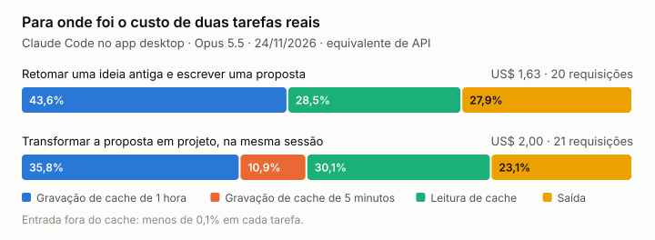

# Claude Code enxuto

Quanto custa cada tarefa que você faz no Claude Code, e para onde vai esse dinheiro. Aqui estão a ferramenta que mede isso a partir dos transcripts que o Claude Code já grava na sua máquina, o capítulo 1 do livro *Claude Code enxuto*, um checklist de uma página e os dados brutos das medições do livro.

*English: [below](#english).*

<picture>
  <source media="(prefers-color-scheme: dark)" srcset="imagens/custo-por-classe-escuro.svg">
  
</picture>

Antes de medir, eu achava que o caro era a resposta do modelo. Na primeira tarefa que medi, ela foi menos de um terço da conta. A maior parte foi para a gravação de cache de 1 hora: tudo o que entra na conversa (arquivo lido, saída de comando, resposta do modelo) é gravado a 2x o preço de entrada, para ser relido barato depois.

| Tarefa | Requisições | Custo | Gravação de cache de 1 hora | Gravação de cache de 5 minutos | Leitura de cache | Saída |
|---|---:|---:|---:|---:|---:|---:|
| Retomar uma ideia antiga e escrever uma proposta | 20 | US$ 1,63 | 43,6% | 0,0% | 28,5% | 27,9% |
| Transformar a proposta em projeto, na mesma sessão | 21 | US$ 2,00 | 35,8% | 10,9% | 30,1% | 23,1% |

## Rode na sua última sessão

Python 3.9 ou mais novo, só a biblioteca padrão. A ferramenta só lê arquivos locais; nada sai da sua máquina.

```bash
git clone https://github.com/AuggieAlmeida/claude-code-enxuto
cd claude-code-enxuto
python measure/measure_task.py list --all
python measure/measure_task.py measure <começo do id da sessão>
```

O `list` mostra as sessões recentes, com custo e título. O `measure` junta a conversa principal e os subagentes, conta cada requisição uma vez e separa o custo nas cinco classes de token, além de mostrar o contexto da primeira requisição. Para comparar uma configuração com outra, registre cada tentativa com `record`, inclusive as que falharam, e rode o `compare`. O [capítulo 1](capitulo-1.md) explica cada coluna e a unidade que importa: o custo por tarefa concluída.

## O que tem aqui

| Arquivo | O quê |
|---|---|
| [`measure/measure_task.py`](measure/measure_task.py) | `list`, `measure`, `record` e `compare`; saída em inglês com `--lang en` |
| [`measure/prices.json`](measure/prices.json) | preços da API por classe de token, com a data em que foram conferidos; modelo sem preço sai como desconhecido, nunca estimado |
| [`capitulo-1.md`](capitulo-1.md) | Medir antes de mexer: a ferramenta, as cinco classes de token e a linha de base |
| [`checklist.md`](checklist.md) | as mudanças do livro numa página, cada uma com o número medido e onde ela não vale |
| [`dados/`](dados/) | as 112 tentativas medidas para o livro, sem nada pessoal, em JSON e CSV; o `compare` lê o JSON direto |
| [`tests/`](tests/) | `python -m unittest discover -s tests` |

## Cuidados

- **O custo é o equivalente de API.** Na assinatura, ninguém cobra esse valor: ele mostra quanto cada tarefa pesa na cota. Para ver quanto da cota já foi, use o `/usage`. Para comparar uma configuração com outra, o equivalente de API é a mesma régua em qualquer plano.
- **O formato do transcript é interno ao Claude Code** e pode mudar entre versões. As medições do livro usaram o CLI 2.1.318 e o app desktop 2.1.330.
- **Os números são de um dia**, 24/11/2026, numa base só. O seu número vai ser outro; por isso a ferramenta vem antes do livro.

## O livro

*Claude Code enxuto* mede cada mudança que promete gastar menos com o Claude Code: execuções repetidas e intercaladas, mediana, uma mudança por vez e a tentativa que falhou contada na conta. Mostra também o que rendeu menos que a fama e o que deixou a conta mais cara. São doze capítulos, da abertura que o modelo lê antes do seu pedido até a escolha entre continuar a sessão ou abrir outra. Edição 0.9, datada: cada edição traz a data e as versões medidas, e os benchmarks rodam de novo quando sai uma versão que mexe nisso.

O livro completo sai em 2027. Para ser avisado, use **Watch → Custom → Releases** neste repositório: cada edição nova vira uma release.

## Licença

- **Código** (`measure/`, `tests/`): MIT, no arquivo [LICENSE](LICENSE).
- **Dados** (`dados/`): [CC BY 4.0](https://creativecommons.org/licenses/by/4.0/deed.pt-br). Use e cite.
- **Capítulo 1, checklist e imagens:** [CC BY-NC-ND 4.0](https://creativecommons.org/licenses/by-nc-nd/4.0/deed.pt-br). Leia e compartilhe com crédito, sem uso comercial e sem versão modificada.

---

## English

How much each task you run in Claude Code costs, and where the money goes. `measure_task.py` reads the transcripts Claude Code already writes on your machine, adds the subagents to the main conversation, counts each API request once and prices it per token class: input, 5-minute cache writes, 1-hour cache writes, cache reads and output. Python 3.9+, standard library only, nothing leaves your machine.

```bash
git clone https://github.com/AuggieAlmeida/claude-code-enxuto
cd claude-code-enxuto
python measure/measure_task.py --lang en list --all
python measure/measure_task.py --lang en measure <session id prefix>
```

The unit that matters is cost per *completed* task: record every attempt with `record`, failed ones included, and `compare` divides the phase's total cost by the attempts that got done.

The chart above: in two real tasks in the desktop app (Opus 5.5, 24/11/2026, API-equivalent cost), output was less than a third of the bill; the largest class was the 1-hour cache write.

[`dados/`](dados/) holds the raw data behind the book, 112 measured attempts with nothing personal, as JSON (readable by `compare`) and CSV with English column names. The book and chapter 1 are in Portuguese first; the English edition comes next.

License: code MIT; data CC BY 4.0; chapter 1, checklist and images CC BY-NC-ND 4.0.
